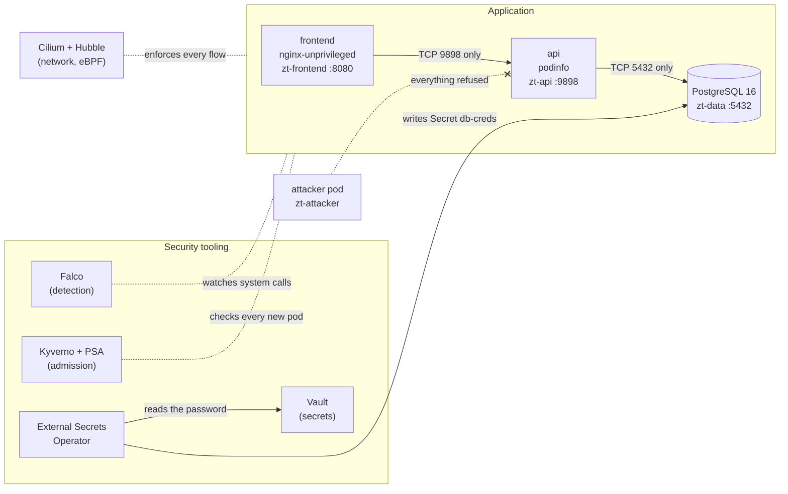
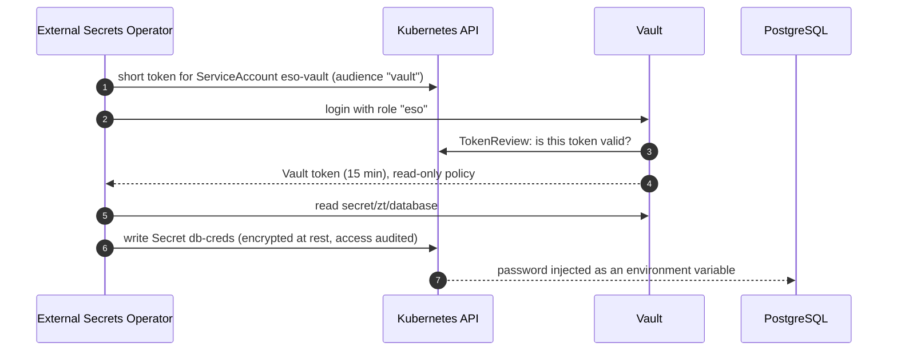

# Kubernetes Zero Trust Architecture

[](https://github.com/penelopeeckhar/kubernetes-zero-trust-architecture/actions/workflows/ci.yml)

A reproducible Zero Trust lab on Kubernetes. We take a small three-tier application, attack it from
a compromised pod, then add security layers one by one and **measure** after each layer what the
attacker can still do. A tool is kept only if it removes a risk that the previous layers left open.

DevSecOps mini-project, ENSA Fès (GDNC), 2026. Abir Majdi (part A) and Doha El Merabet (part B).

## Deliverables

| | |
|---|---|
| Report (PDF, French) | [`docs/report/Rapport_Zero_Trust.pdf`](docs/report/Rapport_Zero_Trust.pdf), LaTeX sources in [`docs/report/latex/`](docs/report/latex/) |
| Technical report (Markdown, English) | [`docs/report/report.md`](docs/report/report.md) |
| Demo video (4 min) | [Google Drive](https://drive.google.com/file/d/1gj5EWyhtxk6pGZi1-1RBWAKOx2ShKWZ_/view?usp=drive_link), details in [`docs/video/`](docs/video/) |
| Architecture diagrams | [`docs/architecture/README.md`](docs/architecture/README.md) |
| Evidence (every number below) | [`docs/evidence/`](docs/evidence/) |

## Contents
1. [The question](#1-the-question)
2. [Architecture](#2-architecture)
3. [Attack scenarios](#3-attack-scenarios)
4. [Security layers](#4-security-layers)
5. [Results](#5-results)
6. [How a secret reaches the database](#6-how-a-secret-reaches-the-database)
7. [Limits](#7-limits)
8. [Reproduce the lab](#8-reproduce-the-lab)
9. [Repository layout](#9-repository-layout)
10. [Team, method and versions](#10-team-method-and-versions)

## 1. The question

> How can the Zero Trust principle be applied to Kubernetes workloads without multiplying
> security mechanisms unnecessarily?

By default, Kubernetes trusts too much: every pod can reach every other pod, every ServiceAccount
gets a token, and the API server accepts privileged containers. **Our answer: start with the native
mechanisms (RBAC, NetworkPolicy, Pod Security Admission), then add a tool only when a measured risk
remains.** The four attack scenarios are replayed after each layer by one script
([`scripts/measure.sh`](scripts/measure.sh)), so every claim is backed by a file in `docs/evidence/`.

## 2. Architecture

Each tier runs in its own namespace. The attacker is a pod inside the cluster, and the scenarios
assume the attacker already runs code in the **frontend**.



Two single-node k3s v1.36.5 clusters were used: **zt-lab-a** (Debian 13) and **zt-lab-b**
(Ubuntu 24.04). Running on two operating systems shows the results do not depend on one machine.
Detailed diagrams (before/after, every allowed flow, the Vault/ESO sequence):
[`docs/architecture/README.md`](docs/architecture/README.md).

## 3. Attack scenarios

| ID | What the attacker in the frontend tries | MITRE ATT&CK |
|---|---|---|
| **S1** | Reach other services: the database, the Kubernetes API, the Internet | T1046, T1059 |
| **S2** | Use the pod's ServiceAccount token to read Secrets or create pods | T1528, T1552.007 |
| **S3** | Start a privileged pod that mounts the node filesystem (`hostPath: /`) | T1610, T1611 |
| **S4** | Read the database password | T1552 |

## 4. Security layers

Each layer answers a precise question, and each one is checked by a test.

| Layer | Tool | What it does here | Closes | Owner |
|---|---|---|---|---|
| Identities | RBAC, no token mounted | Application ServiceAccounts have **no permission** and no token | S2, S4 | A |
| Network | NetworkPolicy enforced by **Cilium** (+ Hubble to see flows) | Default deny in and out, then one rule per legitimate flow | S1 | A |
| Admission | **Pod Security Admission** `restricted` + **Kyverno** | Privileged/`hostPath` pods refused; Kyverno adds image allowlist, no `latest`, CPU/memory limits, generated default deny, and only ESO may write Secrets in `zt-data` | S3 | A |
| Secrets | **Vault** + **External Secrets Operator** | The password lives in Vault (versioned, rotated); ESO copies it into the Secret the database reads. A stolen token cannot log into Vault | S4 | B |
| Traceability | API **audit** log + **encryption at rest** (AES-CBC) | Every Secret access is logged (who, what, when, never the value); a stolen datastore backup reveals nothing | S4 | B |
| Detection | **Falco** (eBPF) + Falcosidekick UI | Five project rules tagged MITRE: shell in a container, token read, outbound connection from the data tier, interactive access to Vault, read of Vault storage | S1, S2, S4 visible | B |
| Supply chain | **Trivy**, Gitleaks, CI | Image scan; no secret can be committed; Kyverno policy tests on every push | — | A, B |

Why not more? Cilium L7 rules stay a demonstration (NetworkPolicy already closes S1), Kyverno does
not duplicate PSA, and there is no service mesh because none of our scenarios measures its benefit.
Full justification, tool by tool: report, section 10.

## 5. Results

### What the compromised frontend can still do after each layer

Source: [`docs/evidence/blast-radius.md`](docs/evidence/blast-radius.md). Identical on zt-lab-a and zt-lab-b.

| After | API | Database | Kubernetes API | Internet | Reads Secrets | Creates pods | S3 privileged pod | S4 password |
|---|---|---|---|---|---|---|---|---|
| Baseline (nothing) | ✅ | ✅ | ✅ | ✅ | ✅ | ✅ | accepted | readable |
| + RBAC | ✅ | ✅ | ✅ | ✅ | ❌ | ❌ | accepted | no |
| + NetworkPolicy | ✅ | ❌ | ❌ | ❌ | ❌ | ❌ | accepted | no |
| + Pod Security Admission | ✅ | ❌ | ❌ | ❌ | ❌ | ❌ | **refused** | no |
| + Kyverno | ✅ | ❌ | ❌ | ❌ | ❌ | ❌ | **refused** | no |
| **All layers** (+ Vault, ESO, Falco) | ✅ | ❌ | ❌ | ❌ | ❌ | ❌ | **refused** | **no** |

✅ = the attacker succeeds, ❌ = blocked. Only the legitimate flow (frontend → API, port 9898) stays open.

### Key numbers

| Measure | Result | Evidence |
|---|---|---|
| Rules available to the frontend account in `zt-data` | 96 → 23 (only default discovery rules) | `docs/evidence/baseline/`, `integration/` |
| Network targets reachable from the frontend | 4 → 1 | `docs/evidence/network/` |
| Kyverno tests (`kyverno test admission/tests/`) | 6 / 6 passed, also in CI | `docs/evidence/rebuild/` |
| Defects found by the cross-review and fixed | R1 (`initContainer` bypassing 3 policies), R10 (admin could modify `db-creds`) | `docs/evidence/review/` |
| Falco | Database → Internet attempt **blocked by Cilium and detected by Falco** (defence in depth) | `docs/evidence/detection/` |
| kube-bench (CIS k3s 1.9) | 59 pass / 4 fail on both clusters after two fixes (zt-lab-b: 57 / 6 before), all 4 explained | `docs/evidence/final/kube-bench-analysis.md` |
| Kubescape (NSA, MITRE) | 1 real defect on our workloads (C-0013), fixed | `docs/evidence/final/kubescape-analysis.md` |
| Trivy (4 application images) | 222 HIGH/CRITICAL, **all fixable** by an update, accepted for the lab | `docs/evidence/final/trivy-analysis.md` |
| Rebuild from scratch with this README only | zt-lab-a in 47 min, zt-lab-b in 55 min, 6/6 criteria each | `docs/evidence/rebuild/` |
| Cost (idle, `kubectl top`) | security tools ≈ 895 MiB vs application 35 MiB | report, section 10 |

## 6. How a secret reaches the database

No password is written in Git or by hand. Vault is the only source of truth.



Rotation is one command, [`secrets/rotate-db-password.sh`](secrets/rotate-db-password.sh): it changes
the password in PostgreSQL, writes a new version in Vault, forces ESO to sync and tests a real
connection. Only hashes are ever printed. Details: [`docs/flows-vault-eso.md`](docs/flows-vault-eso.md).

## 7. Limits

We prefer a written limit to a false promise. The main ones:

- **Single node**: compromising the node defeats every control.
- The legitimate frontend → API flow stays open and could be abused (an L7 policy would narrow it).
- Lab shortcuts: Vault without TLS and with one unseal key, encryption key and audit log on the same
  node, Kyverno with one replica (fail-open on a clean stop, about 30 s fail-closed on a crash, measured).
- Application images are not up to date and not pinned by digest (222 fixable vulnerabilities).
- DNS remains a possible exfiltration channel; pod-to-pod traffic is not encrypted.
- Falco detects but does not block.

Full table with possible improvements: report, section 9.

## 8. Reproduce the lab

Run every command from the repository root. Versions are pinned in [`versions.md`](versions.md);
shared names are defined in [`docs/01-interface-contract.md`](docs/01-interface-contract.md).
Secrets, audit, encryption and detection steps (Vault, ESO, Falco) are detailed in
[`docs/reproduce-secrets-detection.md`](docs/reproduce-secrets-detection.md).

Prerequisites on a fresh VM (found by the rebuilds on both clusters): `curl`, `openssl`, Helm 3
(tested with v3.22.1), the Cilium CLI (v0.20.2) and the Kyverno CLI **1.19.2**, which is used by
`kyverno test` in step 7 (release archive `kyverno-cli_v1.19.2_linux_x86_64.tar.gz` from
https://github.com/kyverno/kyverno/releases). `kubectl` comes with k3s.

```bash
# 1. Audit and encryption drop-ins, BEFORE k3s (step 1 of docs/reproduce-secrets-detection.md)
sudo mkdir -p /etc/rancher/k3s/config.yaml.d /var/lib/rancher/k3s/server/logs
sudo cp cluster/audit/audit-policy.yaml /var/lib/rancher/k3s/server/audit-policy.yaml
sudo cp cluster/audit/k3s-audit.yaml /etc/rancher/k3s/config.yaml.d/20-audit.yaml
sudo cp cluster/audit/k3s-secrets-encryption.yaml /etc/rancher/k3s/config.yaml.d/30-secrets-encryption.yaml

# 2. k3s (pinned, without Flannel, kube-proxy network policy or Traefik)
# on a machine that already ran k3s: sudo /usr/local/bin/k3s-uninstall.sh && sudo rm -rf /etc/cni/net.d, then reboot
# (the uninstall leaves /etc/cni/net.d, so the node would be Ready before Cilium is installed)
sudo cp cluster/k3s-config.yaml /etc/rancher/k3s/config.yaml
curl -sfL https://get.k3s.io | INSTALL_K3S_VERSION=v1.36.5+k3s1 sh -
# the file is mode 0600 for root: copy it, do not just export KUBECONFIG
mkdir -p ~/.kube && sudo cp /etc/rancher/k3s/k3s.yaml ~/.kube/config && sudo chown $USER:$USER ~/.kube/config && chmod 600 ~/.kube/config
# wait until the node is registered (a check run too early answers "No resources found");
# on a clean machine the node only becomes Ready after Cilium, so do not wait for Ready here
until kubectl get node -o name 2>/dev/null | grep -q .; do sleep 5; done

# 3. Cilium 1.20.4 (replaces kube-proxy, VXLAN tunnel, Hubble relay and UI)
cilium install --version 1.20.4 \
  --set cluster.name=default \
  --set kubeProxyReplacement=true \
  --set k8sServiceHost=127.0.0.1 --set k8sServicePort=6443 \
  --set routingMode=tunnel --set tunnelProtocol=vxlan \
  --set ipam.operator.clusterPoolIPv4PodCIDRList=10.42.0.0/16 \
  --set operator.replicas=1 \
  --set hubble.relay.enabled=true --set hubble.ui.enabled=true
cilium status --wait

# 4. Namespaces (with Pod Security "restricted" labels), application and RBAC
kubectl apply -f app/00-namespaces.yaml
# initial hand-made Secret (random value): the database reads it, Vault copies it in step 5, ESO then takes it over
kubectl create secret generic db-creds -n zt-data \
  --from-literal=password="$(openssl rand -base64 32 | tr -d '/+=' | cut -c1-24)"
kubectl apply -f app/ -f rbac/

# 5. Vault, External Secrets Operator and Falco: steps 2 to 4 of
#    docs/reproduce-secrets-detection.md

# 6. Network policies (Cilium, default deny)
kubectl apply -f network/

# 7. Kyverno chart 3.9.2 (PolicyException enabled), then the admission policies
helm repo add kyverno https://kyverno.github.io/kyverno/ && helm repo update
helm install kyverno kyverno/kyverno -n kyverno --create-namespace --version 3.9.2 \
  --set features.policyExceptions.enabled=true \
  --set features.policyExceptions.namespace=kyverno
kubectl -n kyverno rollout status deploy/kyverno-admission-controller --timeout=600s   # slow links: images take minutes
kubectl apply -f admission/   # if it says "no endpoints available", wait a minute and run it again
kyverno test admission/tests/

# 8. ServiceAccount hardening: LAST, after Kyverno (step 5 of docs/reproduce-secrets-detection.md)
./scripts/harden-serviceaccounts.sh

# 9. Measurements
./scripts/measure.sh <label>
```

**After any reboot of the VM or of the Vault pod:** run `./secrets/vault-unseal.sh` (Vault restarts
sealed; ESO keeps the last known Secret and resynchronises once Vault is unsealed). The unseal file
`~/vault-init.json` stays outside the repository and must never be committed.

## 9. Repository layout

```text
app/          application: namespaces (PSA labels), frontend, API, database, attacker pod
rbac/         ServiceAccount used by ESO to log into Vault
network/      default deny + one NetworkPolicy per allowed flow (Cilium)
admission/    Kyverno policies, PolicyException and their CLI tests
secrets/      Vault values and scripts (unseal, configure, rotate, verify), SecretStore, ExternalSecret
cluster/      k3s configuration, audit policy, encryption at rest
detection/    Falco values with the five project rules, test pod
scripts/      measure.sh (S1 to S4), harden-serviceaccounts.sh
docs/         threat model, architecture, flows, reviews, report, video, evidence/
versions.md   every pinned version
```

## 10. Team, method and versions

| | Part A: Abir Majdi (zt-lab-a, Debian 13) | Part B: Doha El Merabet (zt-lab-b, Ubuntu 24.04) |
|---|---|---|
| Built | threat model, baseline, RBAC, NetworkPolicy + Cilium, PSA + Kyverno, CI, measure script | Vault + ESO, API audit, encryption at rest, Falco, kube-bench on zt-lab-b, Trivy, architecture diagrams |
| Together | integration (phase 7), cross-reviews, rebuild from scratch on both VMs, report and video | |

Method: one GitHub issue per task, assigned to its author and closed only with its evidence in
`docs/evidence/`; signed commits; a Gitleaks pre-commit hook and the CI (Gitleaks + `kyverno test`).
Each author reviewed the other's work ([`docs/reviews/`](docs/reviews/)).

Tags: `v0.1-baseline` (unprotected application), `v0.9-integration` (all layers), `v1.0.0` (final),
`v1.0.1` (video link), `v1.0.2` (report PDF and video page in the repository).
Versions: k3s v1.36.5, Cilium 1.20.4, Kyverno 1.19.2, Vault 2.0.4, External Secrets Operator 2.14.0,
Falco 0.45.2, all pinned in [`versions.md`](versions.md).

More documentation: [threat model](docs/00-threat-model.md), [test sheet](docs/02-test-sheet.md),
[interface contract](docs/01-interface-contract.md), [NetworkPolicy vs Cilium](docs/architecture-networkpolicy-vs-cilium.md),
[Falco flows](docs/flows-falco.md), [reproduce secrets and detection](docs/reproduce-secrets-detection.md).
