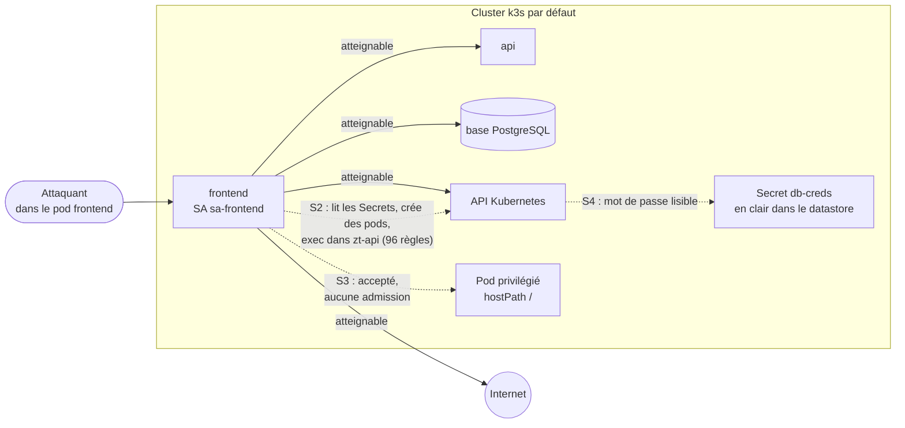
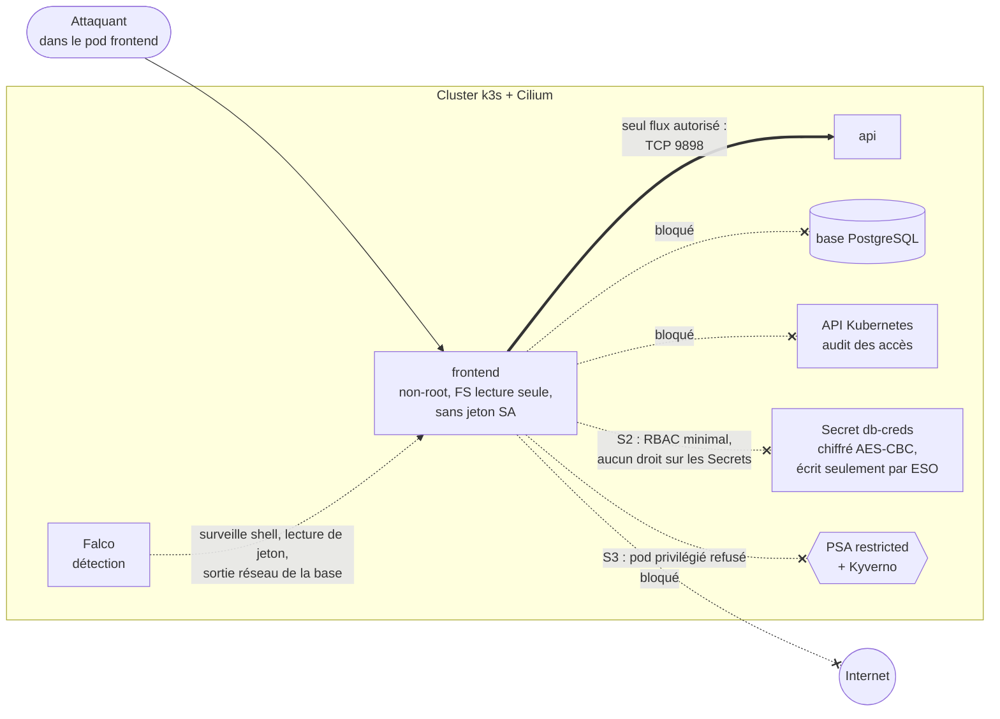
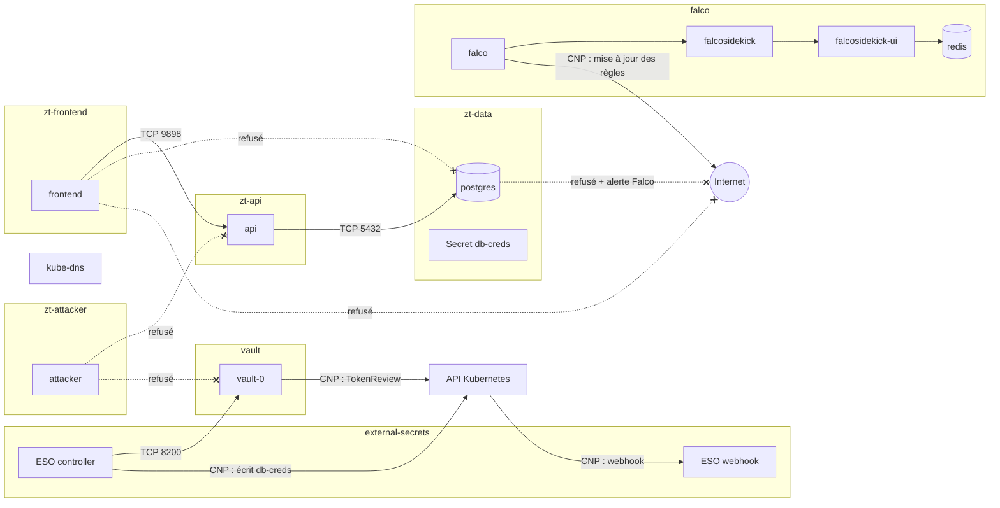
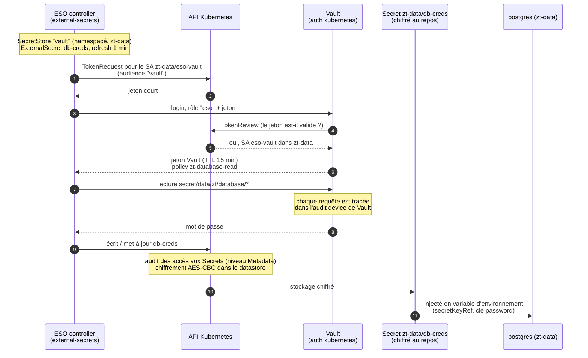
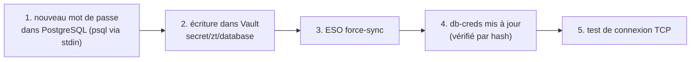

# Architecture

Trois vues de l'architecture du projet :
1. [Avant / après](#1-avant--après) : ce que pouvait faire un pod compromis, avant et après les contrôles Zero Trust ;
2. [Flux réseau autorisés](#2-flux-réseau-autorisés) : tout ce qui n'est pas sur ce schéma est refusé ;
3. [Flux des secrets Vault → ESO → base](#3-flux-des-secrets--vault--eso--base-de-données).

Les schémas sont en Mermaid, et GitHub les affiche directement.

Sources : les manifestes de `network/`, `admission/`, `rbac/`, `secrets/` et `detection/`, ainsi que les mesures `docs/evidence/baseline/` et `docs/evidence/integration/` (identiques sur zt-lab-a et zt-lab-b).

## 1. Avant / après

Scénario : le frontend est compromis (exécution de code dans le pod `frontend`).

### Avant (cluster par défaut, commit `11cb1d4`)

### Après (Zero Trust)

| Mesure | Avant | Après | Contrôle responsable |
| --- | --- | --- | --- |
| S1 frontend → base | atteignable | bloqué | NetworkPolicy default deny + Cilium |
| S1 frontend → API Kubernetes | atteignable | bloqué | NetworkPolicy default deny + Cilium |
| S1 frontend → Internet | atteignable | bloqué | NetworkPolicy default deny + Cilium |
| S2 droits de `sa-frontend` | lit les Secrets, crée des pods, exec | aucun | RBAC minimal, pas de jeton monté |
| S3 pod privilégié + hostPath | accepté | refusé | Pod Security Admission `restricted` + Kyverno |
| S4 mot de passe lisible | oui | non | Vault + ESO, RBAC, Kyverno `secrets-only-from-eso` |

## 2. Flux réseau autorisés

Chaque namespace a une politique `default-deny-all` (entrée et sortie) et une règle DNS vers `kube-dns`. Le schéma montre les seules exceptions. Les flèches pointillées barrées sont des flux testés et refusés.

Tous les pods peuvent aussi joindre `kube-dns` sur le port 53 (règles `allow-dns-egress`). Pour ne pas surcharger le schéma, ces flux ne sont pas dessinés.

Le flux de la base vers Internet illustre la **défense en profondeur** : il est bloqué par Cilium, et la tentative est aussi détectée par Falco.

| Namespace | NetworkPolicy (Kubernetes) | CiliumNetworkPolicy (CNP) |
| --- | --- | --- |
| `zt-frontend` | default deny, DNS, sortie vers l'API | — |
| `zt-api` | default deny, DNS, entrée depuis le frontend, sortie vers la base | — |
| `zt-data` | default deny, DNS, entrée depuis l'API | — |
| `zt-attacker` | default deny, DNS | — |
| `external-secrets` | default deny, DNS, sortie vers Vault | sortie vers l'API Kubernetes, entrée du webhook |
| `vault` | default deny, DNS, entrée depuis ESO | sortie vers l'API Kubernetes |
| `falco` | default deny, Falco → sidekick → UI → redis | DNS, téléchargement des règles |

Les flux vers l'API Kubernetes passent par des CiliumNetworkPolicy (entité `kube-apiserver`). Une NetworkPolicy standard ne peut pas les exprimer de façon fiable, car l'adresse de l'API dépend du nœud.

## 3. Flux des secrets : Vault → ESO → base de données

Le mot de passe de la base n'existe que dans Vault. ESO le recopie dans le Secret Kubernetes `zt-data/db-creds`, seul objet que la base consomme. Aucun humain ni aucun autre pod ne peut écrire ce Secret (politique Kyverno `secrets-only-from-eso`).

### Rotation (`secrets/rotate-db-password.sh`)

Les secrets passent toujours par l'entrée standard (stdin), jamais en argument de commande : les arguments de `kubectl exec` apparaissent en clair dans le journal d'audit.

### Ce que voit chaque identité

| Identité | Vault | Secret `db-creds` |
| --- | --- | --- |
| SA `zt-data/eso-vault` (via ESO) | lecture de `secret/data/zt/database/*` seulement | écriture (seul écrivain autorisé) |
| SA `sa-frontend` | login refusé | aucun droit |
| SA `sa-attacker` | login refusé | aucun droit |
| Administrateur du cluster | — | lecture possible, **écriture refusée** par Kyverno (relecture R10) |
